<p align="center">
  
</p>

<h1 align="center">Your AI. Your Mac. Private by design.</h1>

<p align="center">
Local AI that runs <strong>entirely on your Apple-Silicon Mac</strong> —
on-device LLM inference, live voice, a personal knowledge graph with RAG,
encrypted call transcription, a local agent, and an MCP server.<br>
No telemetry. Every network call shows itself and can be switched off.
</p>

<p align="center">
  <a href="https://apps.apple.com/app/id6780230835?pt=120784482&amp;ct=readme-hero&amp;mt=12"></a>
  <a href="https://apps.apple.com/app/id6780230835?pt=120784482&amp;ct=readme-hero-ios&amp;mt=8"></a>
</p>

<p align="center">
  <a href="https://github.com/Round-Tower/M1K3/releases/latest/download/M1K3.dmg"><strong>Download the DMG</strong></a>
  · <a href="https://m1k3.app">m1k3.app</a>
  · <a href="https://testflight.apple.com/join/Fxp2F5Je">TestFlight beta</a>
  · <a href="https://m1k3.app/agents">Connect a coding agent</a>
</p>

<p align="center"><em>macOS 26 Tahoe or later · Apple Silicon · signed &amp; notarized (Developer ID)</em></p>

<p align="center">
  <a href="https://apps.apple.com/app/id6780230835?pt=120784482&amp;ct=readme-badge&amp;mt=12"></a>
  <a href="https://github.com/Round-Tower/M1K3/releases/latest"></a>
  <a href="https://github.com/Round-Tower/M1K3/actions/workflows/ci.yml"></a>
  <a href="https://github.com/Round-Tower/M1K3/actions/workflows/security.yml"></a>
  <a href="LICENSE"></a>
  
  <a href="https://murphysig.dev/signed/Round-Tower/M1K3/"></a>
</p>

---

## What's inside

- **On-device inference** — three brains: Apple Foundation Models for instant
  answers, Qwen 3 4B, and Gemma 4 12B via MLX. Chat with Mini from the first
  second while a bigger brain downloads.
- **Live voice** — sentence-streamed neural TTS + on-device speech-to-text, and
  a full-window voice mode with karaoke captions.
- **Knowledge + RAG** — drop in notes and PDFs; M1K3 remembers and cites, locally.
- **A memory that repairs itself** — a temporal memory graph of dated facts;
  when you correct something, the dream cycle supersedes the stale fact instead
  of silently losing either version, and keeps the history visible.
- **A face, and creatures** — the Phosphor Fox by default (a white wireframe
  lattice), with the pixel face and a cast of low-poly 3D companions to
  choose from, all rendered on-device with RealityKit.
- **Call memory** — encrypted, on-device call transcription.
- **A local agent** — tools that *do* things, grounded in your own data, with
  markdown + syntax-highlighted code in chat.
- **MCP server** — 18 tools over local HTTP; give Claude and other agents a
  resident with a voice, a memory, and your knowledge.

Everything above runs on the device. M1K3 uses the network for two things: the
one-time download of a bigger brain when you ask for one, and web search, which
is on by default so answers can be current, with one switch in Settings to turn
it off. The Mac App Store build also carries an opt-in Private Cloud Compute
brain — off by default, picked by you, consent asked once, every PCC answer
labelled. The Developer ID DMG has no cloud path at all — see
[SECURITY.md](./SECURITY.md).

| Surface | Where | Stack | Status |
|---|---|---|---|
| **macOS native** | [`macos/`](./macos) | Swift 6.2, SwiftUI, MLX-Swift | **The product** — on-device knowledge · RAG · agent · voice · calls. Build it: [`macos/README.md`](./macos/README.md). |
| **iOS + visionOS** | [`macos/M1K3iOSApp/`](./macos/M1K3iOSApp) | Swift 6.2, SwiftUI | Native SwiftUI shell on the **same** `macos/Sources/` package graph — chat · RAG · memories · docs. Ladder tops out at Lil on-device. See [`macos/docs/IOS_VISIONOS_PORT.md`](./macos/docs/IOS_VISIONOS_PORT.md). |
| **間 AI mobile** | [`app/`](./app) | Kotlin Multiplatform | Slow burn — the **Android** surface (KMP), pre-release. See [`app/README.md`](./app/README.md). |
| **The attic** | git history before `7545b4a4` | Python, THREE.js, Tauri | Where M1K3 grew up — the original CLI, avatar experiments, and ideas. Cleared from the tree 2026-08-13; see [The attic](#the-attic). |

## Get M1K3

- **[Mac App Store](https://apps.apple.com/app/id6780230835?pt=120784482&ct=readme-install&mt=12)** — the easiest way in; it updates through the store.
- **Homebrew** — `brew trust round-tower/tap && brew install --cask round-tower/tap/m1k3` (also puts `m1k3` on your PATH).
- **[Download the DMG](https://github.com/Round-Tower/M1K3/releases/latest/download/M1K3.dmg)** — signed & notarized.
- **Build from source** — [`macos/README.md`](./macos/README.md): clone → `xcodegen generate` → ⌘R.
- **[iPhone & iPad on the App Store](https://apps.apple.com/app/id6780230835?pt=120784482&ct=readme-install-ios&mt=8)** — the same purchase as the Mac app; the ladder tops out at Lil on-device. The [TestFlight beta](https://testflight.apple.com/join/Fxp2F5Je) gets builds first.

## Agents

M1K3 ships a command-line client, `m1k3`, inside the app bundle. It's a thin
client — the running app is the daemon (one MLX slot on the machine, and it
belongs to M1K3.app).

```sh
brew trust round-tower/tap                 # Homebrew 6: trust the tap once
brew install --cask round-tower/tap/m1k3   # the cask symlinks Contents/Helpers/m1k3
# Open M1K3 ▸ Settings ▸ MCP Server: switch it on, then Copy the token
m1k3 login                                 # paste the token (echo off; kept in your keychain)
m1k3 connect claude                        # also: codex · cursor · vscode · zed
```

The MCP server is off until you switch it on, and every request carries its
access token: `m1k3 login` stores it, and `connect` writes it into your agent's
config as an `Authorization: Bearer` header. Without it the server answers 401.

Then `m1k3 status`, `m1k3 ask "what did I decide about the pin?"`,
`m1k3 remember "…"`, `m1k3 search "…"`, `m1k3 speak "build's green"`.

Prefer clicking? **M1K3 ▸ Settings ▸ MCP Server** has the same thing:
pick your agent, copy the snippet (the token is already in it). Already have M1K3 installed? The binary is
at `/Applications/M1K3.app/Contents/Helpers/m1k3`.

### Tell your agents about the resident

`m1k3 agent-notes --write` folds this into a project's `AGENTS.md` (or any path
you name). It's marker-fenced, so re-running it replaces the block rather than
stacking copies:

```markdown
<!-- m1k3:begin -->
## M1K3 is the resident

M1K3 is a local, private assistant running on this Mac, reachable over MCP. It
holds the user's own documents and memories — so before you search the web, ask
it: `ask_m1k3` for a grounded answer, `search_knowledge` for the sources behind
one. Persist a durable fact with `remember` and it is there next session too.
`speak` narrates aloud, which is often kinder than a wall of text.

M1K3 can be down — a "disconnected" MCP server just means the app is closed.
Never block on it; carry on without it.
<!-- m1k3:end -->
```

One honest caveat: the **App Store build's helper is sandboxed**, so it
can't write another app's config file or run `claude` for you. There, `m1k3
connect` prints the config to paste instead — and says so. The Developer ID
build (the DMG and the Homebrew cask) does the write.

## MCP integration

<p align="center">
  <a href="https://mcprush.com/to/m1k3-mcp?ref=badge"></a>
</p>

The running Mac app serves MCP over HTTP at `http://127.0.0.1:4242/mcp` —
knowledge search, documents, voice, and `ask_m1k3` (ask the resident AI).
Every request carries the server's access token (Settings ▸ MCP Server);
`m1k3 login && m1k3 connect claude` wires Claude Code in. Setup for any
client: [`macos/docs/MCP_SETUP.md`](./macos/docs/MCP_SETUP.md).

### Tools

<!-- MCP-TOOLS:START -->
<!-- generated by mcp-inventory at 2026-09-15 19:17 — do not hand-edit; run: mcp-inventory --inject README.md --server m1k3 -->

_18 tools (generated live from the running server)._

| Tool | Required args | What it does |
|------|---------------|--------------|
| `ask_m1k3` | — | Ask M1K3's local brain a question |
| `forget_memory` | query | Permanently forget a fact M1K3 remembers — the consent primitive, the counterpart to remember |
| `get_answer` | job_id | Fetch the result of an ask_m1k3 call that returned a job id because it was taking a while |
| `get_document` | id | Fetch the text of one indexed item by its id (from list_documents) |
| `get_status` | — | M1K3's overall status: active brain tier, TTS provider, voice tier, and the busy flags — whether M1K3 is speaking, in a conversation, using its mic, or already answering an ask_m1k3 call |
| `list_documents` | — | List the items M1K3 has indexed, with their ids, kinds, and titles. |
| `list_jobs` | — | List recent ask_m1k3 jobs — id, state (running/done/error), and age in seconds |
| `list_todos` | — | The user's todo list as M1K3 holds it |
| `listen` | — | Listen on M1K3's microphone and return the transcript once the speaker pauses (or the timeout passes) |
| `memory_stats` | — | How many atomic facts M1K3 currently remembers (the live, non-superseded count) |
| `open_link` | url | Open a web link in M1K3's review panel on the user's screen, beside the conversation, so they can see the page |
| `propose_todo` | title | PROPOSE a todo for the user |
| `recall_memory` | query | Recall atomic facts M1K3 remembers about the user — the temporal memory GRAPH, separate from the document corpus search_knowledge reads |
| `related_memory` | query | Recall the single best matching fact for the query, then walk M1K3's memory GRAPH one step out to its neighbours (linked or superseded facts) |
| `remember` | title, text | Store text in M1K3's memory — it becomes part of what M1K3 knows, searchable in every future conversation (the same store search_knowledge reads) |
| `search_knowledge` | query | Search M1K3's stored knowledge (documents, calls, notes; hybrid retrieval when available) |
| `speak` | text | Speak text aloud through M1K3's voice (and animate the avatar) |
| `stop_speaking` | — | Stop any in-progress speech immediately. |

<!-- MCP-TOOLS:END -->

> The table above is generated live from the running app — never hand-edit it.
> Refresh with `mcp-inventory --inject README.md --server m1k3` (needs the M1K3 app running).

## The attic

M1K3 didn't start as a Mac app. It started in August 2025 as a Python CLI with
a synthesized voice, grew a THREE.js avatar, a PWA, a Tauri popover, a RAG
engine, and an MCP server — and then everything it learned was rebuilt native.
That history is signed and permanent in this repo's git history — a project
about provenance should keep its own. The `attic/` tree was cleared from the
working copy on 2026-08-13; to walk through it, check out any commit before
`7545b4a4` (or resurrect it with `git checkout 7545b4a4 -- attic`).

## Contributing

Start with [`CONTRIBUTING.md`](./CONTRIBUTING.md). Architecture and current
state: [`CLAUDE.md`](./CLAUDE.md). Security reports: [`SECURITY.md`](./SECURITY.md).

The quickest way to help: if M1K3 earns a place on your Mac, star the repo
(it's how other people find it), and open an issue when something breaks.

## Privacy

Inference, retrieval, and voice run on-device; M1K3 itself has no servers and
never sees or stores your conversations. Two things can leave the machine, each
a switch: web search and the lookups it makes (on by default) and, in the Mac App Store build only, the
opt-in Private Cloud Compute brain (off by default) — when you pick it, your
message goes to Apple's Private Cloud Compute, and the conversation so far only
if you tick it. See [SECURITY.md](./SECURITY.md) for what is and is not sent
and Apple's own guarantees, quoted and linked.

## License

**[Functional Source License, FSL-1.1-ALv2](./LICENSE).** M1K3 is
source-available and **free for humans, forever**: read every line, build it,
modify it, run it for yourself, use it inside your organisation, teach with
it, research with it. What the licence does not permit is a *competing use* —
offering M1K3, a fork of it, or a substantially similar product to others as a
commercial product or service. Each version converts to Apache-2.0 two years
after release. It is not an OSI open-source licence and we don't call it one.
Attribution and third-party notices are in [`NOTICE`](./NOTICE); the decision
and its reasons are in
[ADR 0005](./macos/docs/adr/0005-relicense-to-fsl-organisations-are-the-paid-line.md).

Revisions before 2026-09-09 were published under Apache-2.0 and stay that way;
the boundary is recorded in `NOTICE`.

The source is public; the name is not. **M1K3**, the M mark, the pixel face
and CRT look, the icon, and the voice are trademarks and brand assets, all
rights reserved and outside the licence grant. See
[`TRADEMARKS.md`](./TRADEMARKS.md). The companion creatures are not ours: the
Fox is the Khronos glTF sample by PixelMannen (CC0) and tomkranis (CC-BY 4.0);
Colobus, Gecko, Inkfish and Sparrow are by [Quaternius](https://quaternius.com)
(CC0) — credited in `NOTICE` and in the app's Third-party licenses screen. The only official builds are Round Tower's
(`app.m1k3` on the App Store and TestFlight, and the DMGs on [m1k3.app](https://m1k3.app)).

**Organisations:** M1K3 for Teams — the same on-device brains, institutional
memory, and a tuned persona served on your own Apple Silicon hardware, under
your own domain — is licensed separately.
See [m1k3.app/teams](https://m1k3.app/teams) or write to hello@round-tower.ie.

Contributions are by invitation under a short [CLA](./CLA.md) (Apache-2.0
inbound, FSL outbound). M1K3 is built in the open with
[MurphySig](https://murphysig.dev) provenance — the git history is signed,
human-and-AI collaboration on the record.

<!-- Signed: Kev + claude-fable-5.1, 2026-10-09, Confidence 0.85, Prior: Unknown (the README predates
     this signature). The network and privacy paragraphs say what ships: web search on by default, PCC
     opt-in in the App Store build, no cloud path on the DMG — "the 1.0 build has no cloud path" was
     written before the rung shipped (first live generation 2026-09-15).
     Review: Kev + claude-fable-5.1, 2026-10-09 (PR #527 fold) — web search names the lookups it makes
     (Wikipedia, page fetches), so the clause matches the chat's egress answer.
     Review: Kev + claude-opus-5.5, 2026-10-11 — Mac App Store live: CTAs and install copy switch from TestFlight. Get M1K3 is Mac
     App Store, Homebrew, DMG, source, then TestFlight for iPhone and iPad; the header links lead
     with the store; the sandboxed-helper caveat drops "(TestFlight today)"; the official-builds
     line names the store. Confidence 0.85.
     Review: Kev + claude-opus-5.5, 2026-10-11 — App Store campaign links: each store link carries pt=120784482
     (Round Tower's provider token) and its own ct, so App Store Connect counts which door converts and the
     page still tracks nobody. JSON-LD keeps the canonical URL. Confidence 0.85.
     Review: Kev + claude-opus-5.5, 2026-10-11 — repo optics: the hero's store link is Apple's own
     "Download on the Mac App Store" badge (hotlinked from Apple's marketing toolbox, as Apple
     offers it; still ct=readme-hero), the DMG link reads "Download the DMG", and Contributing
     asks for a star once, plainly. Confidence 0.85.
     Review: Kev + claude-fable-5.1, 2026-10-20 — mcprush graded the MCP server A (93/100 trust, verified
     publisher); its live card sits under MCP integration, not in the shields row, because a 380×200 card
     would swamp the small badges. The card is hotlinked and updates itself. Confidence 0.85.
     Review: Kev + claude-fable-5.1, 2026-10-20 — header on brand: the H1 is the site's line ("Your AI. Your
     Mac. Private by design."), not "Own your AI", which appears nowhere else; the shields are flat-square
     in the hero's palette (black label, #e8e8e8 value), MurphySig the one accent; the GitHub workflow
     badges became shields so the row is one style; the Claude review badge is gone (it tells a user
     nothing); the release shield reads "nightly DMG" because the nightly tag always wins "latest", and
     the App Store version comes from shields' itunes source; the emoji and arrow are gone. Status badges
     are monochrome on purpose, so a failing CI still says "failing" but not in red. Confidence 0.8.
     Review: Kev + claude-opus-5.5, 2026-10-22 — iPhone & iPad are live (1.2.0, released 2026-10-21 on
     the same record as the Mac app): the hero carries Apple's "Download on the App Store" badge beside
     the Mac one (mt=8, ct=readme-hero-ios), Get M1K3 links the iOS store page (ct=readme-install-ios)
     with TestFlight as the early channel, and the header's TestFlight link reads "TestFlight beta".
     Confidence 0.85. -->
<!-- Signed: Kev + claude-fable-5.1, 2026-10-09, Confidence 0.85 (the v1.1.0 pass: the two
     "1.0 build has no cloud path" sentences now describe PCC as the opt-in third crossing,
     consent per conversation per ADR 0007; the MCP count of 18 was re-read off
     M1K3MCPKit + M1K3BrainServe the same day). Prior: Unknown. -->
