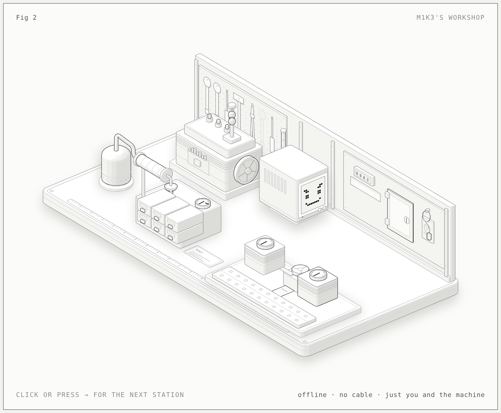

# Figures

Interactive explainer figures of M1K3, drawn as working machines with
[Anatomy](https://github.com/wheresryan22/anatomy) (MIT), an agent skill for isometric SVG figures. Each
page is a standalone HTML file: open it in a browser, click or press → to step through it. The light
pages print well, and every number on them comes from the repo (each `build.mjs` header names its source).

| Figure | What it explains | Files |
|---|---|---|
| **Fig 1 · M1K3's tool router** | The two heads that sort a chat turn before any model runs: the gate (P(tool) ≥ 0.322, fails open) and the group head (≥ 0.763; web and script never dispatched). Seven example asks; their scores are illustrative. | [`tool-router/`](tool-router/) |
| **Fig 2 · M1K3's workshop** | The whole concept as a mechanic's bench: offline brain, weight digests, Cool Head, the face's heartbeat, memory distillation (dedupe 0.95), the egress wall, and paired evals (MoE Big round 3, +3/−8). | [`workshop/`](workshop/) |
| **A4 poster** | Fig 2 with 12 numbered parts, four numbers and the lead. | [`workshop/workshop-poster-a4.pdf`](workshop/workshop-poster-a4.pdf) |



## Rebuilding

The builds import Anatomy's kit from a clone; the figures were made against commit `1482e84`.

```bash
git clone https://github.com/wheresryan22/anatomy /tmp/anatomy && git -C /tmp/anatomy checkout 1482e84
export ANATOMY=/tmp/anatomy
node tool-router/build.mjs && node tool-router/build.mjs --light
node workshop/build.mjs && node workshop/build.mjs --light
node "$ANATOMY/scripts/lines.mjs" workshop/workshop.html        # must print "line ends: 0"
```

The headless checks (`lines.mjs`, `capture.mjs`) need Chrome; set `CHROME_PATH` if it isn't found.

## The poster

`workshop/sheet.mjs` is the poster's spec. `print.mjs` freezes the light page, pins the parts and lays out
the poster HTML next to the spec, then prints it with Chrome:

```bash
node "$ANATOMY/scripts/print.mjs" workshop/sheet.mjs --png
```

Where Chrome's `--print-to-pdf` hangs (it did in a headless Linux container), print the laid-out HTML
with Playwright instead, at the figure width the poster was made with:

```bash
node print-pdf.cjs workshop/workshop-poster-a4.html workshop/workshop-poster-a4.pdf workshop/workshop-poster-a4.png 0.74
```

## Truth rule

A figure's motion, readouts and caption must be true. When a source number changes (a router retrain, a
new dedupe floor, a new audition), update the constant in the `build.mjs` header and body, rebuild, and
reprint the poster. Illustrative values are labelled as such in the caption.
